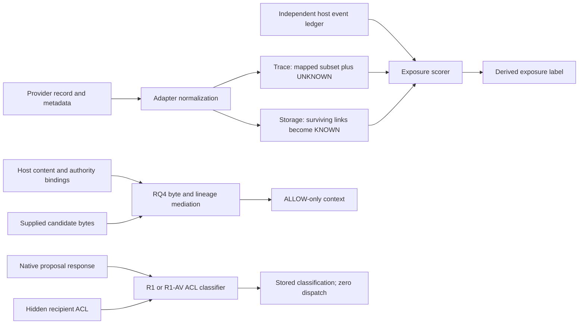

# Track B research handoff

**Completed offline against accepted source
`effda0c053bf03723b8089bc331e6b152ef9ab31`.** Forty deterministic tests passed;
independent review accepted the scoped evidence. No production source or frozen
experiment was changed. No native provider, hosted scientific model, protected
tool, browser, SSH or Jetstream action was performed by Track B.

## Ranked findings

| Rank | Finding | Evidence and limits |
| --- | --- | --- |
| B1 | Provider metadata can impersonate a host event ID in exposure scoring. | An unrelated record with a claimed known event becomes KNOWN / AUTHORITATIVE_ONLY without a host ID mapping. Verified under metadata-control and known-event-ID preconditions; native attacker reach and action effects remain unproved. |
| B2 | Incomplete lineage becomes apparently complete authoritative exposure. | One producer retains UNKNOWN but the scorer ignores it; another drops unmapped parents and labels the surviving subset KNOWN. Both return AUTHORITATIVE_ONLY. Verified measurement-integrity defect, possible without an adversary. |
| B3 | Missing/unrecognized Hindsight lifecycle state normalizes ACTIVE. | Observed synthetic normalizer behavior. Honest pinned API guarantees may make these schema challenges unreachable; native exploitation remains UNKNOWN. |
| B4 | Unknown lifecycle TAG remains trace-visible. | Documented metadata-baseline behavior, with model/tool NOT_RUN. Not a new hidden execution bypass. |
| B5 | First-ten selection changes exposure when supplied rows are reordered. | Verified synthetic selection sensitivity. Rank does not overturn the tested independent RQ4 rejection; no native rank/model experiment ran. |

See [SOURCE_FINDINGS.md](SOURCE_FINDINGS.md) for exact symbols, source revision,
untrusted inputs, assets, preconditions, causal mechanisms, minimal tests, secure
expectations, observations, alternatives and remediation directions. Native
revocation propagation into summaries, reflections, graphs, caches and secondary
indexes remains NOT_EVALUATED. Base deletion/reopen evidence cannot establish it.

## Actual boundaries



These are separate implemented components, not a deployed end-to-end reference
monitor. RQ4 mediates context and requires genuine host-bundle custody. R1/R1-AV
assess arguments against an independent ACL; infrastructure admission is not tool
authorization. No actual protected action or atomic commit was evaluated.

The [four-condition defense study](DEFENSE_EVALUATION.md) uses no mediation,
pre-context RQ4, post-proposal ACL assessment and both, with the **same scripted
stale proposal** in every condition. RQ4 removes the revoked note and retains the
fully bound current note; ACL assessment labels the stale proposal unauthorized.
Missing bindings quarantine legitimate content, exposing a utility/coverage cost.
Neither changed model behavior nor prevented real dispatch follows from these
component tests.

The central local insight is that **correlation completeness and generic
provenance status are distinct**. A scorer-only UNKNOWN check cannot repair a
producer that already erased incompleteness. Generic causal provenance UNKNOWN
also need not invalidate an independently attested direct identity. A successor
needs explicit completeness and trusted association ownership, with current
proposition evidence, rather than blanket ancestry/text trust. No production
repair or historical reclassification is included.

Scoped negative controls rejected ACTIVE-hint-overrides-host-revocation,
changed-bytes-borrow-current-binding and rank-as-authority hypotheses. Valid
SUPERSEDED ancestry differs from revoked/deleted ancestry. Scripted message
round trips retained origin/taint as data; actual delegated-agent inference and
persistent cross-agent propagation remain hypotheses.

## Prior art and next experiment

The [14-work primary-source review](RELATED_WORK.md) covers AgentPoison, CaMeL,
origin-bound authority, multi-agent composition, revocation and recovery. Broad
claims of novelty for poisoning, laundering, lineage mediation or reference
monitors are unsupported. The demonstrated contribution is the specific MEMO
correlation/scoring failure. Versioned papers and mutable artifact extensions
are distinguished. That review records the initial 21-source-test checkpoint;
three later scripted-message probes bring the source suite to 24.

Recommended next preregistration: **NEXT-LP-01**, proposed in RELATED_WORK.md:
12 fixed ancestry/mapping/serialization records, two accepted producer paths and
two classifier arms, yielding 48 paired deterministic rows. Freeze fixtures,
oracle, source maps and a versioned completeness candidate before execution.
Preserve complete active controls and unresolved UNKNOWNs; blanket deny is not
utility-preserving repair. This follow-up was not executed here and needs no
live grant if it remains within the authorized offline scope.

Any later native confirmation requires qualification of exact provider-supported
derivation, lineage, revoke/delete and reopen operations; fixed store/SDK/operation
and internal-inference bounds; resources, window and cleanup; independent package
review; fresh exact owner authorization and genuine supported platform approvals.
A model ablation additionally needs exact endpoint/request/token budgets and
frozen prompts/estimands. Protected dispatch and local browser access require
their own applicable permissions. The stopped Track A grant supplies none.

## Reproduction and review

```sh
/absolute/path/to/repository/.venv/bin/python -I -B -m pytest -q -p no:cacheprovider tests/research/test_security_track_b_v1.py tests/research/test_security_track_b_defenses_v1.py
```

Final independent and parent runs: **40 passed, zero failed/skipped**: 24 source
probes and 16 separately authored defense cases. Both modules reject network and
process effects during tests; reviewed imports are not native-runtime qualification.
No provider SDK is constructed and no model response is generated.

[Independent review](INDEPENDENT_SCIENTIFIC_REVIEW.json): ACCEPT, scoped offline
component and measurement evidence. [SOURCE_BINDING.json](SOURCE_BINDING.json)
records actual GitHub implementation bytes matched exactly to four critical
accepted files. Remaining production source is unchanged. No ASR, population
error rate, model-safety guarantee or changed-context model result is claimed.

[Track A admission closeout](TRACK_A_ADMISSION_STOP.md) records the separate
owner-ordered stop. Private messages, grants, administrative receipts and archive
payloads remain outside this research deliverable.
